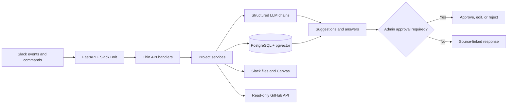

# Slack PM Agent

A Slack-first project management assistant for software teams. It records
authorized project conversations, extracts requirements and tasks on demand,
answers source-linked questions, and keeps every proposed work item behind an
explicit admin approval step.

## What It Demonstrates

- Event-driven Slack automation with FastAPI and Slack Bolt.
- Structured LLM pipelines for scope extraction, document analysis, decision
  requests, project updates, and multilingual huddle notes.
- Retrieval-augmented Q&A over project memory and parsed document chunks using
  PostgreSQL and pgvector.
- Approval-gated task creation with edit, reject, and bulk-approval workflows.
- Clear separation between client-facing and internal project channels.
- A read-only Slack Canvas dashboard for operational project state.
- Read-only GitHub activity summaries for commits and pull requests.
- Retry-safe event ingestion, source provenance, bounded document processing,
  and role-aware access checks.

## Architecture



The API layer only handles Slack transport. Business rules live in service
modules, database access is isolated in query modules, and model prompts are
versioned as plain Markdown files.

## Safety and Data Boundaries

- Administrative commands and approvals are restricted to Slack IDs listed in
  `GLOBAL_ADMIN_SLACK_IDS`.
- Project-manager identity is used only to classify conversation participants;
  it does not grant administrative access.
- Client-channel and internal-channel content follow separate retrieval and
  response paths. Document Q&A is limited to the internal project channel.
- GitHub integration exposes read methods only.
- Slack retries are deduplicated before processing.
- Uploaded files are capped at 25 MiB. Large parsed documents remain stored and
  searchable, while automatic full-document analysis is bounded by chunk,
  character, and page limits.
- No credentials, Slack exports, production messages, or customer documents are
  included in this repository. Local secrets belong only in `.env`, which is
  ignored by Git.

Only connect the app to channels whose participants have approved message and
document processing. Define an appropriate retention policy before deploying it
with real project data.

## Technology

- Python 3.10+
- FastAPI and Slack Bolt
- PostgreSQL, SQLAlchemy async, Alembic, and pgvector
- OpenAI chat and embedding APIs behind an LLM adapter
- PyMuPDF and python-docx for document parsing
- pytest and pytest-asyncio

The adapter interface supports additional model providers, but the current
implementation ships with the OpenAI adapter only.

## Quick Start

### 1. Install

```bash
git clone <repository-url>
cd slack-pm-agent

python3 -m venv .venv
source .venv/bin/activate
python -m pip install -r requirements.txt
```

### 2. Configure local environment

```bash
cp .env.example .env
```

Edit `.env` with your own development credentials:

| Variable | Required | Purpose |
|---|---:|---|
| `DATABASE_URL` | Yes | Async PostgreSQL URL using the `asyncpg` driver |
| `SLACK_BOT_TOKEN` | Yes | Slack bot token |
| `SLACK_SIGNING_SECRET` | Yes | Verifies incoming Slack requests |
| `SLACK_APP_TOKEN` | No | Needed only for Socket Mode |
| `LLM_PROVIDER` | Yes | Currently `openai` |
| `LLM_MODEL` | Yes | Chat model used by structured chains |
| `OPENAI_API_KEY` | Yes | OpenAI API credential |
| `EMBEDDING_MODEL` | Yes | Embedding model used for semantic retrieval |
| `GITHUB_TOKEN` | No | Read-only access to private repos or higher API limits |
| `GLOBAL_ADMIN_SLACK_IDS` | Yes for setup | Comma-separated Slack IDs allowed to administer the bot |
| `LOG_LEVEL` | No | Application logging level; defaults to `INFO` |

### 3. Prepare PostgreSQL

```bash
createdb pm_agent_dev
psql pm_agent_dev -c "CREATE EXTENSION IF NOT EXISTS vector"
alembic upgrade head
```

The database user needs permission to create the pgvector extension, or an
administrator must enable it before migrations run.

### 4. Start the API

```bash
uvicorn pm_agent.app.main:get_app --factory --reload --port 3000
```

`GET /health` reports API and database connectivity. For local Slack request
delivery, expose port 3000 with a trusted HTTPS tunnel.

## Slack App Configuration

Configure these request URLs in the Slack app dashboard:

| Slack feature | Request URL |
|---|---|
| Event Subscriptions | `https://your-public-host/slack/events` |
| `/agent` slash command | `https://your-public-host/slack/commands` |
| Interactivity | `https://your-public-host/slack/interactions` |

Subscribe to `message.channels`, `message.groups`, `app_mention`, and
`file_shared`. The bot uses these scopes:

```text
canvases:write
channels:history
channels:read
chat:write
commands
files:read
groups:history
groups:read
im:write
users:read
```

After changing scopes, reinstall the Slack app so its token receives the new
permissions. Canvas support also depends on the connected Slack plan.

## Commands

| Command | Access | Purpose |
|---|---|---|
| `/agent setup-project` | Admin | Map client/internal channels and an optional GitHub repo |
| `/agent gather-info` | Admin | Extract sourced requirements, tasks, decisions, and risks |
| `/agent update` | Admin | Generate a private, reviewable client update draft |
| `/agent status` | Admin and developer | Show project state |
| `/agent blockers` | Admin and developer | Show blocked tasks and pending clarifications |
| `/agent ask <question>` | Admin and developer | Answer questions from permitted project context |
| `/agent clarify <question>` | Admin and developer | Search known answers or raise a decision request |
| `/agent huddle-notes` | Admin and developer | Parse pasted English, Urdu, or Roman Urdu notes |
| `/agent help` | Admin and developer | Show role-specific help |

Developers can query implementation scope, confirmed requirements, tasks,
blockers, and sources. Commercial terms, private notes, cross-project data, and
client-commitment questions require admin access.

## Document Pipeline

Supported inputs are PDF, DOCX, TXT, and Markdown files shared in configured
project channels. Processing follows this sequence:

1. Register Slack file metadata and deduplicate the event.
2. Download with authorization and size checks.
3. Reject login/error HTML masquerading as a file.
4. Parse and chunk supported content.
5. Generate bounded embeddings and structured analysis.
6. Store provenance for retrieval and Canvas summaries.

Scanned PDFs are not OCR'd. They fail with a clear parse status when no text can
be extracted.

## Testing

```bash
python -m pytest
```

The suite contains 154 tests covering permissions, Slack formatting, event
deduplication, approval workflows, clarifications, document safety and parsing,
semantic retrieval, source tracking, and Canvas synchronization. GitHub Actions
runs the same suite on every push and pull request.

## Repository Layout

```text
.
├── pm_agent/app/
│   ├── agents/          # LLM adapter, schemas, chains, and Markdown prompts
│   ├── api/             # Slack event, command, and interaction handlers
│   ├── db/              # ORM models, query modules, and Alembic migrations
│   ├── services/        # Business workflows and external integrations
│   ├── utils/           # Permissions, formatting, parsing, and source helpers
│   ├── config.py        # Environment-backed settings
│   └── main.py          # FastAPI application factory
├── tests/               # Unit and service-level regression suite
├── .env.example         # Safe configuration template
├── alembic.ini
├── pyproject.toml       # Test configuration
└── requirements.txt
```

## Design Principles

1. Slack is transport; service modules own behavior.
2. Collection is quiet, but analysis is command-driven.
3. Suggested work requires explicit approval.
4. Answers and extracted items retain source provenance.
5. Fail closed when permissions or model-based classification are uncertain.
6. Keep third-party repository access read-only.
